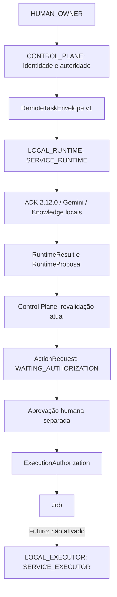

# LUMA — arquitetura remota preparada localmente

Estado 7F-A2; Backend 0.6.0rc1. Verificação: Codex, 2026-10-24.
A implementação é local. Não há deployment, URL pública, login Google,
enrollment criptográfico ou executor Codex ativado.

LUMA_MODE aceita CONTROL_PLANE, LOCAL_RUNTIME e LOCAL_DEV. Ausente significa
LOCAL_DEV para preservar a CLI existente; qualquer outro valor falha fechado.
O entrypoint escolhe a factory antes de importar implementação do outro papel.

CONTROL_PLANE: backend/control_plane_app.py. Usa Control, ExecutionService,
DeviceRegistry, RuntimeTaskService e audit chain existentes. Possui DB canônico.
Não instancia modelo, cliente Knowledge ou ADK. O health consulta schema/status
sem retornar connection string, paths ou secrets. Continua limitado a localhost
e autenticação Owner local; autenticação cloud pertence à 7F-B.

LOCAL_RUNTIME: backend/local_runtime_app.py e runtime_processor.py.
Não importa SQLAlchemy, psycopg, Store, Control, grants, approvals ou jobs.
Não oferece rotas approve/authorize/grant/unlock; a única rota HTTP é health.
Recebe trabalho pela interface interna de transporte, ainda sem polling real.
Recusa variáveis de credenciais Owner/admin/DB. Chaves Gemini e Knowledge
são locais. O subprocesso ADK preserva isolamento e não recebe essas chaves.

LOCAL_DEV mantém rotas históricas e suas verificações, mas chamadas ao modelo
passam por EnvelopeModelProvider → LocalRuntimeTransport → RuntimeTaskProcessor.
Usa os mesmos schemas/serialização JSON e handler do runtime separado.
MODEL_GENERATION é a operação de compatibilidade integrada; ANALYZE é a operação
do gateway separado. O gateway canônico recusa respostas MODEL_RESULT externas,
portanto contexto Knowledge completo não é enviado ao Control Plane separado.

A política de proposals é reutilizada em app/proposal_flow.py; não foi criada
uma segunda fonte de aprovação. O catálogo enviado é dado versionado, não grant.
Nenhum componente de runtime transforma review de segurança em aprovação humana.

Fontes: backend/__main__.py, backend/modes.py, backend/control_plane_app.py,
backend/control_plane_tasks.py, backend/runtime_processor.py,
backend/local_dev_transport.py. Testes: test_remote_boundary.py e
postgres_tests/test_remote_boundary_pg.py. Evidência operacional cloud: não existe.

## Configuração dos processos locais

- Control Plane: LUMA_MODE=CONTROL_PLANE; LUMA_OWNER_TOKEN e, quando usados,
  LUMA_RUNTIME_TOKEN/LUMA_ADMIN_CONFIRM_TOKEN; LUMA_DATABASE_BACKEND e
  LUMA_DATABASE_URL. Nenhuma chave Gemini/Knowledge é necessária.
- Runtime: LUMA_MODE=LOCAL_RUNTIME; LUMA_DEVICE_ID, LUMA_REGISTRY_VERSION,
  LUMA_MODEL_PROVIDER, LUMA_GEMINI_MODEL=gemini-3.8-flash e credenciais
  Gemini/Knowledge somente locais. Não herdar Owner/admin/database credentials.
- Desenvolvimento integrado: LUMA_MODE=LOCAL_DEV com a configuração histórica.
- Comando: python -m backend na venv existente. Bind local; portas 8770 para
  Control Plane/LOCAL_DEV e 8771 para health do runtime. Nenhum serviço foi
  instalado ou deixado rodando por esta validação.

As rotas de task remota ainda não são públicas. A interface interna do gateway
e o transporte in-process são testáveis por JSON, e FutureRemoteRuntimeTransport
recusa uso. O registry version deve vir do Control Plane; "unbound" no runtime
sem assignment não é autorização para executar ferramenta alguma.
